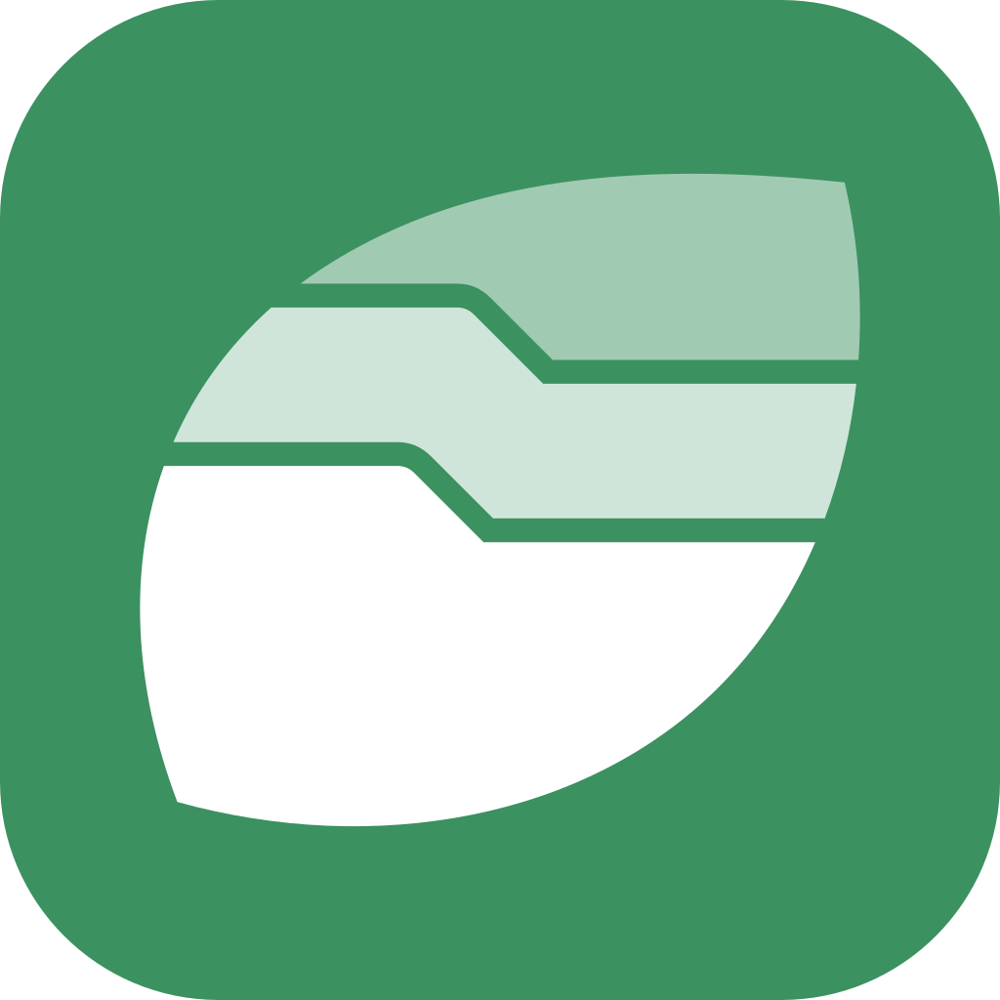

<div align="center">
  
  <h1>Send to Curio</h1>
  <p><strong>Browser extension for Chrome, Edge, and Chromium browsers.</strong><br />Save pictures, video, audio, files, web links, and screenshots straight into any Curio library — open, background, or queued offline.</p>

  <p>
    
    
    
    
  </p>

  <p>
    <a href="#privacy-and-local-first-design">Privacy</a> &middot;
    <a href="#features">Features</a> &middot;
    <a href="#installation-and-pairing">Install &amp; Pair</a> &middot;
    <a href="#shortcuts">Shortcuts</a> &middot;
    <a href="#site-rules">Site Rules</a> &middot;
    <a href="#page-attributes">Page Attributes</a> &middot;
    <a href="#options">Options</a> &middot;
    <a href="#development">Development</a> &middot;
    <a href="#license">License</a>
  </p>
</div>

---

## Privacy and Local-First Design

- **Local loopback only**: *Send to Curio* talks exclusively to [**Curio**](https://github.com/Erehr/curio) running on `127.0.0.1` through Curio's [local HTTP API](https://erehr.github.io/curio/api/) — no external servers, no accounts, and no telemetry.
- **Origin-pinned pairing**: Connecting generates an API token pinned specifically to this extension's origin, visible and revocable at any time under Curio's **Settings › API**.
- **Opt-in authenticated downloads**: Site cookies are disabled by default. When *Send the site's cookies with a download* is enabled, cookies for that exact host are passed in the single download call and never persisted by the extension or Curio.
- **Strict page isolation**: Content scripts never see the API token and cannot call Curio directly; real user gestures (`isTrusted`) are verified before acting, and web pages cannot force fetches against local or LAN addresses.

---

## Features

### Capture Modes
| Method | Behavior |
|---|---|
| **Right-click › Save to Curio** | Opens the save panel for the clicked image, video, audio, link, or page with library, folders, tags, name, notes, rating, custom choice fields, and *Save as link*. |
| **Alt+Click** | Instant quick-save of the image, video, audio, or link under the pointer without triggering the page's click handler. |
| **Drag card** | Pull any image or link to reveal a floating drop card with your library selector and folder tree — drop on a folder to save immediately, or drop on the top zone to open the full edit panel. Respects elements the page marks `draggable="true"`. |
| **Hover button** | Optional *Button* mode places a corner save button over images and videos as you hover. |
| **Toolbar menu** | Open an empty panel (paste, drop, or pick files), *Save page as link*, *Screenshot area*, *Screenshot visible tab*, switch *Mode* (*Drag* / *Button* / *None*) or *Position* (*Card* / *Side panel*), and open Options. |

### Smart Media Extraction & Full-Resolution Upgrades
- **Deep element inspection**: Finds images beneath transparent overlays, inside shadow roots and frames, largest `srcset` / `<picture>` sources, CSS background images, inline SVGs, `<canvas>`, and `blob:` images (skipping icons below the configured minimum size, 48 px by default).
- **Automatic full-resolution upgrades**: Tries original/full-size URLs first (falling back to the displayed copy if unavailable) on Next.js / Vercel image optimizers, `images.weserv.nl`, Wikimedia image thumbnails, X (`name=orig`), Pinterest (`originals`), and Reddit previews.
- **Screenshots & visual page bookmarks**: Area and visible-tab screenshots capture at native screen DPI as PNGs with the source page URL attached. *Save page as link* attaches a tab screenshot as the link's thumbnail so it reflects what you saw without re-fetching. Streaming video/audio (`.m3u8`, `.mpd`, or media `blob:` streams) is saved cleanly as a page link.
- **Resilient download queue**: Internet URLs are handed to Curio's persistent download queue (`item.add.fromUrls`) with `Referer`, `User-Agent`, full-res `alternates`, and duplicate skipping (`onDuplicate: skip`). Browser-only bytes (screenshots, canvases, inline SVGs, `blob:`, or when *Download through the browser* is enabled) upload via `item.add.fromBytes` (up to 44 MB inline, up to 2 GB via Curio's upload endpoint).

### Save Panel & Browser Side Panel
- **Floating card or persistent Side panel**: Opens as a 640 × 640 dialog beside the pointer (or in a popup window on restricted browser pages), or docks permanently in the browser's **Side panel** with optional *Folders between saves* drag-drop mode.
- **Fast filing**: Filter folders with keyboard navigation, create new folders inline (with `organize`), pick from recent folders, save reusable **Presets** (library + folders + tags), use Curio's **Tag picker** (*Starred*, *Recently*, *Recommended* from page title), edit the library's custom choice fields, and optionally sync Curio's live window theme.

### Offline Queue & Background Launch
- **Works when Curio is closed**: Captures made while Curio isn't running are persisted in the extension's IndexedDB queue (up to 500 MB, surviving browser restarts and updates) and flushed automatically once Curio starts.
- **One-click background launch**: Clicking **Open Curio** triggers `curio://open?background=1` to launch Curio quietly in the tray and drain the queue. Every add uses an idempotent `requestId` so retries never create duplicates.

---

## Installation and Pairing

1. Open `chrome://extensions` (or `edge://extensions`), enable **Developer mode**, click **Load unpacked**, and select this folder.
   - The manifest's `key` pins the unpacked extension ID to `chfhdgecmnomfokannimcbbjgghdmejg` so tokens stay paired across reloads and Chromium profiles.
2. Open **Options** from the extension toolbar menu, verify the API port (`41733` by default), and click **Connect**.
3. Curio displays a pairing confirmation dialog with a verification code. Confirm the code matches and choose which libraries the extension may access.
   - Curio issues an origin-pinned token with `library.read`, `metadata.read`, `metadata.write`, `organize`, and `files.write`.
   - Alternatively, click **Other ways** to paste a manually created token from Curio's **Settings › API**.

---

## Shortcuts

| Default shortcut | Command |
|---|---|
| `Alt+Shift+S` | Quick save item under the pointer without opening the panel |
| `Alt+Shift+C` | Open the toolbar menu |
| `Alt+Shift+A` | Screenshot a dragged area (`Esc` to cancel) |
| `Alt+Shift+L` | Save current page as a link (opens panel) |
| *(unbound)* | Screenshot visible tab area |
| *(unbound)* | Quick-save page as link to **All** in the last library |

Customize shortcuts via **Options › Shortcuts › Change** (opens your browser's extension shortcuts page).

---

## Site Rules

Under **Options › Site rules**, define ordered top-to-bottom rules (matching *All* or *Any* conditions) that automate filing and tagging on every save:

| Condition | Matches |
|---|---|
| **Site** | Page hostname or subdomain (comma-separated, e.g. `example.com` matches `img.example.com`). |
| **Page URL, Page title, File URL, Extension** | Contains, equals, starts/ends with, regex (`/…/i`), or negated forms. |
| **Type** | `image`, `video`, `audio`, `file`, `link`, or `page`. |
| **Width, Height** | Pixel dimensions when known by the page. |

**Rule actions**: set destination **Library** and **Folders**, append static **Tags**, extract page tags via a CSS **Tag selector** (up to 30 unique lines), opt into **Use page destination** (`data-curio-library` / `data-curio-folders`), force **Open panel**, or **Stop processing rules**.

---

## Page Attributes

Pages can annotate elements (or any ancestor, with `<meta name="curio:<name>" content="…">` as fallback) so *Send to Curio* captures higher-resolution sources and structured metadata automatically:

| Attribute | Value | Effect |
|---|---|---|
| `data-curio-src` | URL (resolved against page) | Overrides the source URL saved |
| `data-curio-title` | Text (max 200 chars) | Asset name |
| `data-curio-link` | URL | Asset source URL |
| `data-curio-annotation` | Text (max 10,000 chars) | Asset notes |
| `data-curio-tags` | JSON string array or comma-separated list | Appends tags (max 50) |
| `data-curio-rating` | `0`–`5` | Star rating |
| `data-curio-fields` | JSON object `{ key: value }` | Populates existing custom fields |
| `data-curio-library` | Library ID, name, or alias | Destination library (requires a Site rule with *Use page destination*) |
| `data-curio-folders` | JSON array or single folder ID / `Parent/Child` path | Destination folders (requires *Use page destination*) |
| `data-curio-type` | `file` or `link` | Forces saving as a web link |
| `data-curio-referer` | Same-site URL | Custom `Referer` header for download |
| `data-curio-collectable` | Boolean attribute | Marks a non-image element as collectable with `data-curio-src` |
| `data-curio-pending` | Boolean attribute | Delays capture up to 3 s while async metadata resolves |
| `data-curio` | JSON object of any keys above | Shorthand (individual attributes override it) |

`curio-<name>` aliases are also supported, as are Eagle's `eagle-src`, `eagle-title`, `eagle-link`, `eagle-annotation`, `eagle-tags`, and `eagle-src-loading` attributes (enabled by default; toggleable in Options). Before reading attributes, the extension dispatches a bubbling, shadow-crossing `curio:collect` event:

```js
for (const img of document.querySelectorAll('article img')) {
  img.dataset.curioSrc = img.src.replace('/thumb/', '/full/')
  img.dataset.curioTags = JSON.stringify(['from the web', img.closest('article').dataset.author])
  img.dataset.curioLibrary = 'Inspiration'
}
```

> **Security**: Attributes are untrusted page data. Destinations are only followed when a Site rule explicitly enables *Use page destination*, unknown folders are only created when *Let pages create folders* is enabled with `organize`, cross-site attribute URLs never receive cookies, and local/LAN URLs are rejected. See the full [Browser markup specification](https://erehr.github.io/curio/api/connect/browser-markup/) in Curio's documentation.

---

## Options

| Option | Default | Description |
|---|---|---|
| **Port / Connect / Disconnect** | `41733` | Pair with Curio, enter a manual token (*Other ways*), or revoke & disconnect (`token.forget`). |
| **Mode** | *Drag* | *Drag* (drag card), *Button* (hover button on pictures), or *None*. |
| **Use side panel / Folders between saves** | Off | Open the save UI in the browser side panel and optionally show folder drop targets when idle. |
| **Use Curio's theme** | Off | Sync the panel and toast styling with Curio's active theme instead of system light/dark default. |
| **Alt+click to save** | On | Quick-save media or links on `Alt+Click`. |
| **Min image size (px)** | `48` | Ignores images smaller than this threshold in both dimensions. |
| **Disabled sites / Drag disabled on** | Empty | Disable page inspection or drag capture on specific hostnames. |
| **Send site cookies / Download through browser** | Off | Opt-in cookie forwarding or browser-side byte fetching for signed-in sites. |
| **Read `eagle-*` attributes** | On | Fallback compatibility with pages marked up for Eagle. |
| **Let pages create folders / Library aliases** | Off / Empty | Allow `data-curio-folders` creation (with `organize`) and map portable alias names to local libraries. |

---

## Development

<details>
<summary>Architecture, packaging, tests, and Firefox status</summary>

### Architecture

| Component | Role |
|---|---|
| `content/` | Runs in every page/frame: tracks right-clicked targets, inspects DOM/attributes, renders toast notes, drop zones, screenshot cropper, and closed-shadow-root panel host, and reads `blob:`/canvas/SVG bytes. Never sees tokens or calls Curio. |
| `background.js` | MV3 service worker: context menus, capture state (`storage.session`), destination tracking, and short-lived coordination. |
| `sender/` | Offscreen document: handles long-running browser fetches, screenshot cropping, Curio uploads/API calls, and the IndexedDB offline queue (`lib/queue.js`). |
| `launch/` | Hidden frame triggering `curio://` background launch only with a 5-second worker-issued tab grant. |
| `popup/` | Toolbar button menu and quick toggles. |
| `panel/`, `options/` | Extension UI pages (shared panel running in-page `?frame=1`, side panel `?side=1`, or standalone popup window). |
| `lib/` | Shared storage, API connection, capture states, destinations, site rules, and copy. |

### Packaging & Tests

Tests and tooling expect Curio's app checkout at `../app` (override with `CURIO_APP`):

- `npm test` — Runs unit tests in `test/` and checks that `curio.js` matches Curio's client.
- `node tools/ext-pack.mjs` — Builds `target/send-to-curio-<version>.zip` and an unpacked copy (`--store` omits `manifest.json`'s `key` for store publishing).
- `node tools/ext.mjs` — Runs browser integration fixtures (`test/pages/`) against Curio's sandbox (`--chrome`, `--show`, `--only collect --scale 2`).
- `node tools/ext-icons.mjs` — Regenerates `panel/tabler.json` from Curio's Tabler icon set.

### Firefox Status

Not built yet. Moving to Firefox MV3 requires adapting the offscreen document to a DOM event page, `side_panel` to `sidebar_action`, and `browser_specific_settings.gecko.id` (Curio's pairing already accepts `moz-extension://<UUID>` origins).

</details>

---

## Related Repositories

- [**Erehr/curio**](https://github.com/Erehr/curio) — Curio desktop app and [documentation](https://erehr.github.io/curio/).
- [**Erehr/curio-plugins**](https://github.com/Erehr/curio-plugins) — Official optional plugins (Reader, 3D Models, AI Generation).

---

## License

*Send to Curio* is free software under the **GNU General Public License v3.0** ([LICENSE](LICENSE)).
